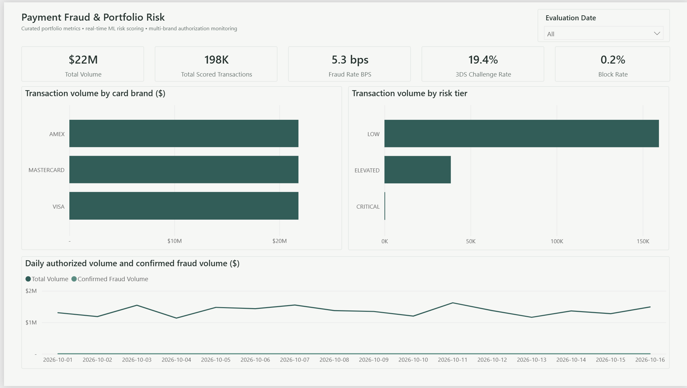
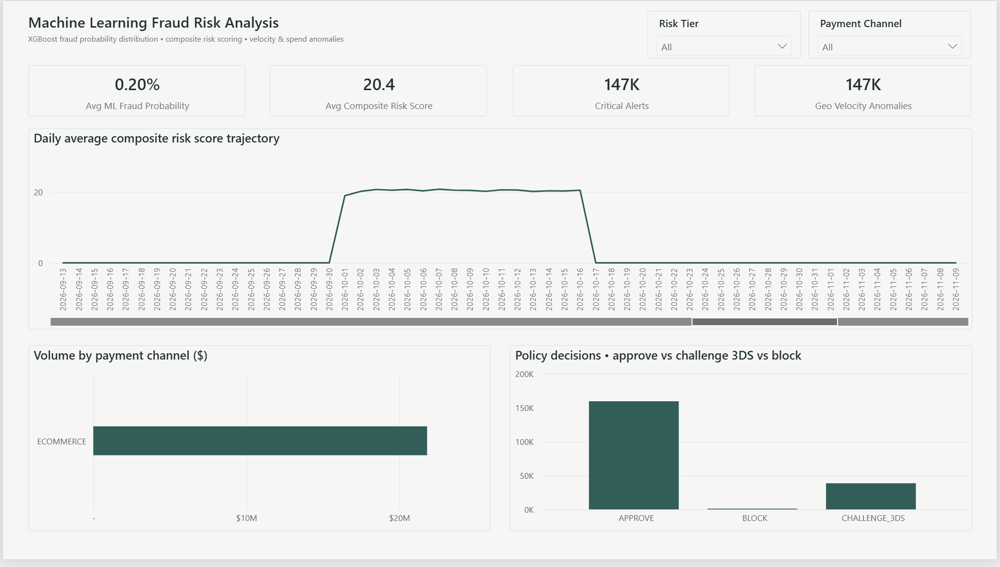
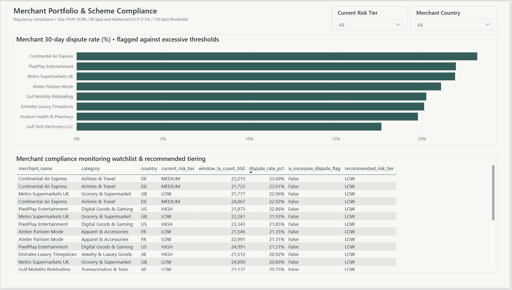
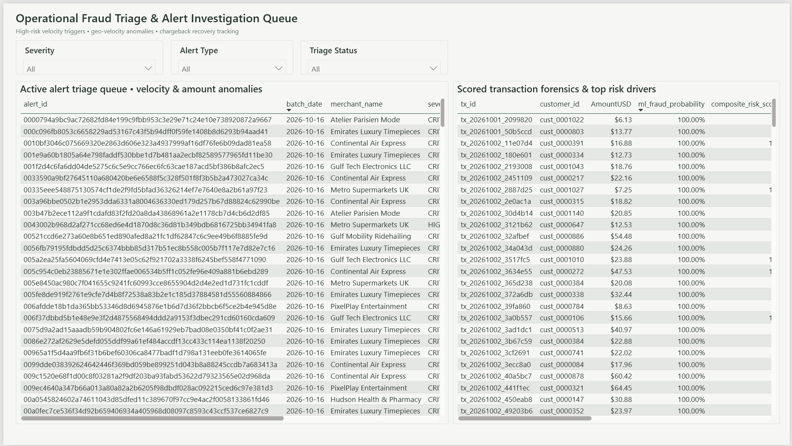

# Payment Fraud & Transaction Risk Monitoring

An end-to-end data pipeline and fraud monitoring system that processes daily payment settlements, detects high-risk transactions with machine learning, feeds Power BI dashboards, and automatically suspends blocked accounts in the operational database.

---

## Architecture

**Stack:** Azure Databricks · Delta Lake · PySpark · MLflow (LightGBM / XGBoost) · Neon PostgreSQL · Azure SQL · Power BI · GitHub Actions

---

## How It Works

1. **Automated Ingestion & CDC**
   - A scheduled producer drops daily transaction, chargeback, and SHA-256 manifest files into Unity Catalog Volumes, triggering the 14-task Databricks workflow on file arrival.
   - **Auto Loader** ingests JSONL streams with schema rescue so unexpected upstream fields do not break runs.
   - Merchant and customer updates are pulled incrementally from Neon PostgreSQL using **watermark-based CDC** rather than full table reloads.

2. **Data Quality & Feature Engineering (Medallion)**
   - **Bronze → Silver:** Records are deduplicated via **idempotent Delta MERGE** operations. Invalid transactions (null IDs, negative amounts, bad coordinates, unsupported currencies) are routed to a **dead-letter quarantine table** instead of being silently dropped.
   - Behavioral and geospatial features are calculated in Spark—including rolling spend baselines (1h, 24h, 7d, 30d Z-scores) and Haversine implied travel speeds to catch impossible travel.

3. **Fraud ML & Risk Decisioning**
   - **Training:** Accounts for **chargeback maturation lag** (disputes take 30–120 days to surface) so recent undisputed transactions do not pollute negative labels.
   - **Model Selection:** Runs an MLflow bake-off between LightGBM and XGBoost, optimizing for **dollar-weighted recall** rather than raw accuracy so high-value fraud is prioritized.
   - **3-Way Actioning:** Combines ML probability with rule overrides to route transactions into `APPROVE`, `CHALLENGE_3DS`, or `BLOCK` based on cost-utility thresholds.

4. **Serving & Reverse ETL**
   - **Gold Marts:** Tracks daily fraud basis points (bps), high-risk alert queues, and rolling 30-day merchant dispute rates aligned with **Visa VFMP compliance thresholds (0.9% and 1.5%)**.
   - **BI Serving:** Publishes curated facts and dimensions to **Azure SQL Database** for Power BI reporting.
   - **Reverse ETL:** Writes `BLOCK` decisions and high-risk merchant flags back to Neon PostgreSQL to suspend compromised accounts automatically.

---

## Power BI Dashboards

### 1. Executive Risk Overview
Tracks gross transaction volume, fraud basis points, decline rates, and estimated losses prevented.

### 2. ML Fraud Risk Analysis
Shows model score distributions, `APPROVE` / `CHALLENGE` / `BLOCK` action splits, and top risk drivers.

### 3. Merchant Risk & Compliance
Monitors 30-day rolling merchant dispute rates against Visa VFMP compliance thresholds.

### 4. Operational Alert Queue
Gives risk analysts a prioritized queue of flagged transactions with travel speed, distance, and spend Z-score context.

---

## Testing & CI/CD

- **Unit Tests:** 57 `pytest` tests covering data validation rules, Haversine and Z-score math, dollar-weighted model evaluation, 3-way risk scoring, and idempotent operational sync (`python -m pytest tests mock_provider_service/tests -v`).
- **CI/CD:** GitHub Actions runs the test suite on every push and automatically syncs `main` into the Databricks workspace via the Repos REST API.
